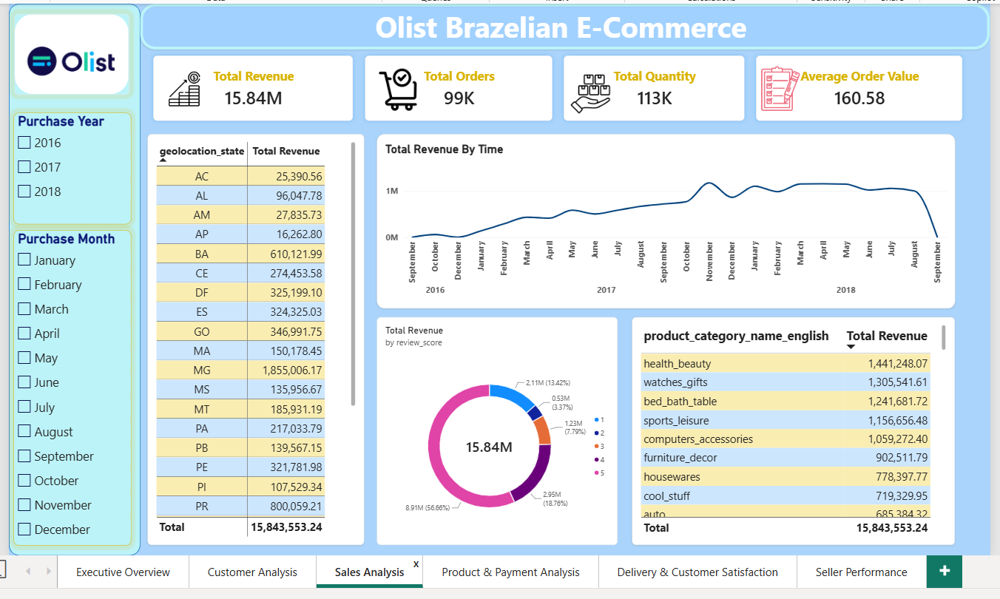
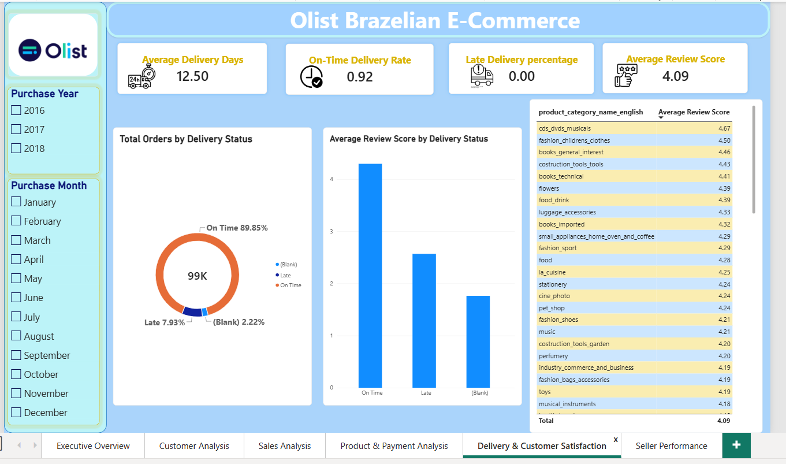
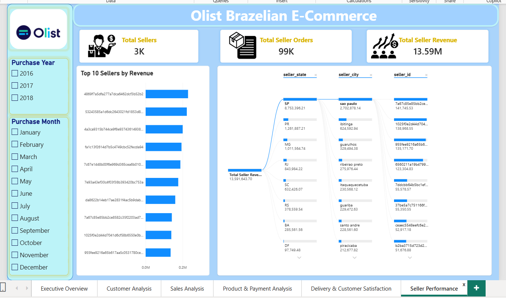

# Brazilian-E-commerce-Olist-
Brazilian E-commerce Data Analysis | Power BI

Project Overview

This project focuses on analyzing Brazilian e-commerce data using Power BI to gain insights into sales performance, customer behavior, product categories, and delivery operations.

I independently developed this project, from exploring the dataset and preparing the data to building an interactive multi-page Power BI report.

Tools & Technologies

- Power BI
- Power Query
- DAX

Project Objectives

- Analyze overall sales and revenue performance.
- Understand customer purchasing behavior.
- Identify the best-performing product categories.
- Analyze sales distribution across Brazilian states.
- Evaluate order delivery performance.
- Explore payment methods and customer reviews.

Key Performance Indicators (KPIs)

- Total Revenue
- Total Orders
- Total Quantity
- Average Order Value
- Late Delivery Orders

Dashboard Features

- Interactive slicers and filters.
- Sales and revenue analysis.
- Product category performance.
- Geographic sales analysis.
- Order and delivery analysis.
- Customer and payment insights.

Project Structure

- Power BI Dashboard (.pbix)
- Dashboard Screenshots
- Project Documentation

Dashboard Preview 

### 1. Executive Overview

### 2. Customer Analysis

### 3. Sales Analysis

### 4. Product and Payment Analysis

### 5. Delivery and Customer Satisfaction

### 6. Seller Performance

Author

Heba Ismail

