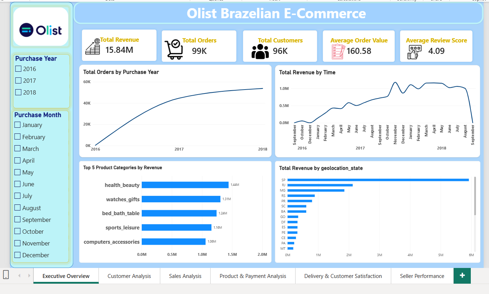
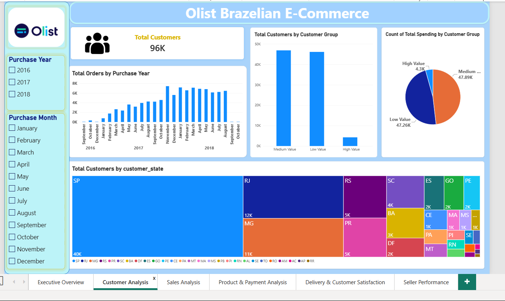
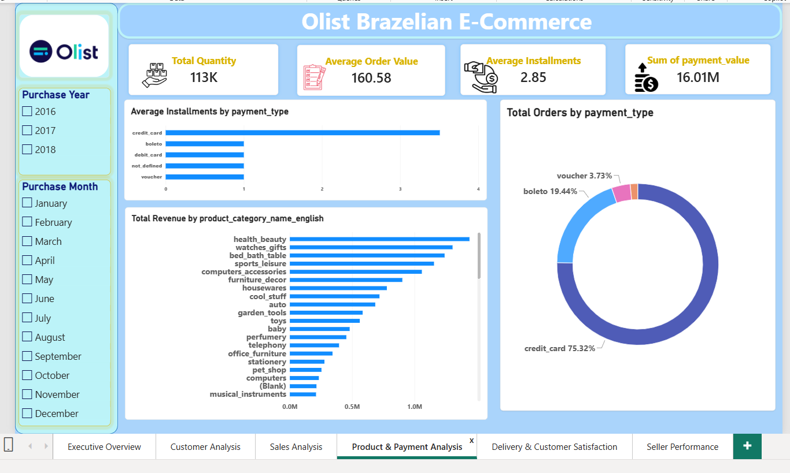

# Brazilian-E-commerce-Olist-
Brazilian E-commerce Data Analysis | Power BI

Project Overview

This project focuses on analyzing Brazilian e-commerce data using Power BI to gain insights into sales performance, customer behavior, product categories, and delivery operations.

I independently developed this project, from exploring the dataset and preparing the data to building an interactive multi-page Power BI report.

Tools & Technologies

- Power BI
- Power Query
- DAX

Project Objectives

- Analyze overall sales and revenue performance.
- Understand customer purchasing behavior.
- Identify the best-performing product categories.
- Analyze sales distribution across Brazilian states.
- Evaluate order delivery performance.
- Explore payment methods and customer reviews.

Key Performance Indicators (KPIs)

- Total Revenue
- Total Orders
- Total Quantity
- Average Order Value
- Late Delivery Orders

Dashboard Features

- Interactive slicers and filters.
- Sales and revenue analysis.
- Product category performance.
- Geographic sales analysis.
- Order and delivery analysis.
- Customer and payment insights.

Project Structure

- Power BI Dashboard (.pbix)
- Dashboard Screenshots
- Project Documentation

Key Insights

Overall Sales & Growth: The project analyzes Olist (a Brazilian e-commerce platform) and shows 15.84M in total revenue from 99K orders and 96K customers, with an average order value of 160.58 and strong sales growth between 2017 and 2018.  

Top Categories: The highest-selling product categories are Health & Beauty, Watches & Gifts, Bed Bath Table, and Sports & Leisure.  

Customer & Location Trends: Most customers and revenue come from São Paulo (SP), followed by Rio de Janeiro (RJ) and Minas Gerais (MG), with the majority of customers falling into the Medium and Low spending groups.  

Payment Methods: Credit cards are the most popular payment method (76.82% of orders), followed by Boleto (19.44%) and Vouchers (3.73%), with an average of 2.85 installments per order.  

Delivery & Customer Satisfaction: Orders take an average of 12.50 days to arrive, and 89.85% of orders are delivered on time, leading to a good overall customer review score of 4.09 out of 5.  

Seller Performance: The platform includes 3K sellers generating 13.59M in seller revenue, with most top-performing sellers located in São Paulo (SP).

Dashboard Preview 

### 1. Executive Overview

### 2. Customer Analysis

### 3. Sales Analysis

### 4. Product and Payment Analysis

### 5. Delivery and Customer Satisfaction

### 6. Seller Performance

Author

Heba Ismail

